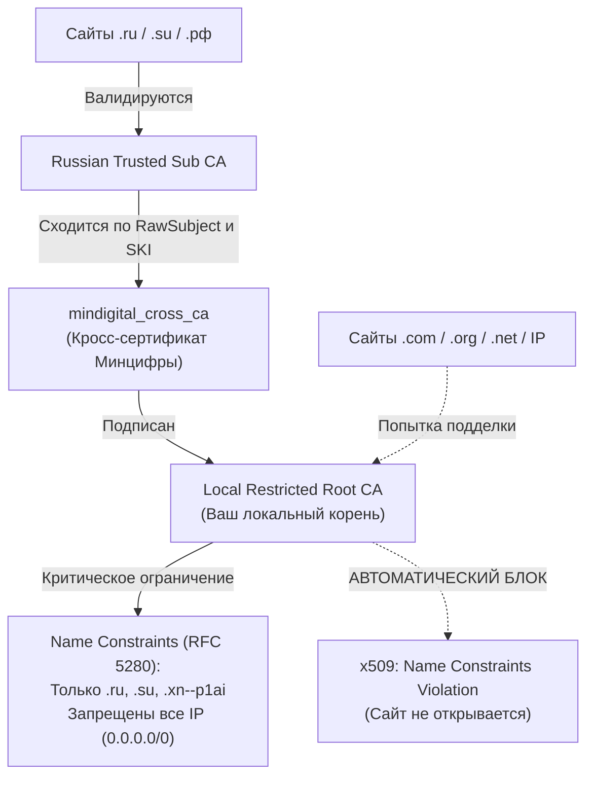

# mindigital-cage 🛡️🔒

> **Безопасная изоляция («клетка») для корневых сертификатов Минцифры с жестким ограничением доменов (RFC 5280 Name Constraints).**

[](https://golang.org)
[](LICENSE)
[]()

---

## 📌 Зачем это нужно?

Для доступа к ряду российских государственных и финансовых сервисов (Госуслуги, Сбербанк, ВТБ, ФНС и др.) требуется наличие корневых сертификатов **Russian Trusted Root CA** («Сертификаты Минцифры»).

### В чем опасность стандартной установки?
Когда вы устанавливаете официальный сертификат Минцифры стандартным способом напрямую в хранилище доверенных корневых центров (Root):
1. Этот центр сертификации получает **неограниченное доверие** в вашей операционной системе.
2. Владелец приватного ключа Минцифры (или лицо, получившее к нему доступ) технически может выпустить действительный SSL/TLS сертификат для **абсолютно любого домена в мире** — например, `google.com`, `telegram.org`, `github.com`, `apple.com`.
3. Это открывает возможность для скрытой атаки «человек посередине» (MITM) и расшифровки вашего личного трафика за пределами Рунета.

---

## 💡 Как работает `mindigital-cage`?

Вместо предоставления полного доверия утилита помещает сертификаты Минцифры в строго ограниченную криптографическую **«клетку»**:



### Архитектурные гарантии:
1. **Официальные источники**: Сертификаты автоматически загружаются по защищенному каналу с официального CDN Госуслуг (`gu-st.ru`).
2. **Локальный корень с Name Constraints**: Генерируется собственный локальный корневой сертификат с критическим расширением `PermittedSubtrees` (только `.ru`, `.su`, `.xn--p1ai` / `.рф`) и запретом IP-адресов.
3. **Кросс-сертификация**: Публичный ключ оригинального корня Минцифры подписывается нашим локальным корнем. Метаданные `RawSubject` и `SubjectKeyId` копируются побайтово, поэтому промежуточный `Russian Trusted Sub CA` образует валидную цепочку.
4. **Самоуничтожение ключа**: Сразу после подписания 4096-битный приватный ключ локального корня **надежно зануляется в оперативной памяти** и никуда не сохраняется. Никто (включая вас самих или вирусы на ПК) физически не сможет использовать этот корень для подписи новых сертификатов.

---

## 🚀 Быстрый старт

### 1. Скачивание
Скачайте готовый бинарный файл для вашей системы со страницы [Releases](../../releases) или скомпилируйте самостоятельно.

### 2. Установка в систему

#### Windows (PowerShell / CMD от имени Администратора):
```powershell
.\mindigital-cage.exe -install
```
> Команда очистит оригинальный корень из Root (если стоял ранее), установит локальный корень в `Root`, а кросс-сертификат и Sub CA — в промежуточное хранилище `CA`.

#### Linux (с правами root / sudo):
```bash
sudo ./mindigital-cage -install
```
> Поддерживаются дистрибутивы с `p11-kit` / `update-ca-trust` (Arch, CachyOS, Fedora, RHEL) и `update-ca-certificates` (Debian, Ubuntu, Mint).

#### macOS:
```bash
sudo ./mindigital-cage -install
```
> Сертификаты будут добавлены в системный `System.keychain`.

---

## 🔍 Проверка и верификация (`-verify`)

Вы можете в любой момент убедиться, что клетка активна и выполняет свои защитные функции:

```bash
mindigital-cage -verify
```

Команда автоматически выполняет 4 уровня проверок:
1. **Целостность файлов**: проверяет наличие всех CRT файлов.
2. **Криптографическая цепочка**: сверяет цифровые подписи между Sub CA -> Cross CA -> Local Root.
3. **Симуляция атак**:
   - Генерирует сертификаты для `.ru` и `.рф` → подтверждает успешную валидацию.
   - Эмулирует попытку выпуска сертификата для `google.com`, `github.com`, `telegram.org` → подтверждает блокировку системы по правилу `Name Constraints`.
   - Эмулирует прямой IP-адрес (`1.1.1.1`) → подтверждает блокировку по правилу `ExcludedIPRanges`.
4. **Аудит хранилища ОС**: проверяет, что оригинальный незащищенный корень Минцифры случайно не остался в доверенных корнях.

---

## 🦊 Настройка Mozilla Firefox

Firefox по умолчанию использует собственную изолированную базу сертификатов (NSS) и игнорирует системное хранилище Windows/Linux.

Чтобы Firefox доверял системным сертификатам:
1. В адресной строке Firefox перейдите на страницу `about:config`.
2. Подтвердите предупреждение.
3. В поиске найдите: `security.enterprise_roots.enabled`.
4. Дважды кликните по нему, чтобы значение стало **`true`**.

---

## 🗑️ Полное удаление из системы

Если вы захотите полностью удалить все установленные сертификаты:

```bash
# Windows (от Администратора):
.\mindigital-cage.exe -uninstall

# Linux / macOS (с sudo):
sudo ./mindigital-cage -uninstall
```

---

## ⚙️ Параметры командной строки

| Флаг | Описание | По умолчанию |
|---|---|---|
| `-install` | Автоматически установить сертификаты в хранилище ОС | `false` |
| `-uninstall` | Удалить установленные сертификаты клетки из системы | `false` |
| `-verify` | Запустить криптографический аудит и симуляцию атак | `false` |
| `-clean-orig` | Удалить оригинальный незащищенный Root CA Минцифры из системы | `false` |
| `-domains` | Пользовательский список разрешенных доменов через запятую | `ru, su, xn--p1ai` |
| `-out` | Папка для сохранения `.crt` файлов сертификатов | `./certs_out` |
| `-version` | Показать версию утилиты | `false` |

---

## 🛠️ Сборка из исходников

Требуется **Go 1.22** или новее:

```bash
# Клонировать репозиторий
git clone https://github.com/username/mindigital-cage.git
cd mindigital-cage

# Запуск тестов
go test -v

# Сборка бинарника для текущей ОС
go build -ldflags="-s -w" -o bin/mindigital-cage .
```

### Кросс-компиляция (без CGO):
```bash
# Для Linux amd64
CGO_ENABLED=0 GOOS=linux GOARCH=amd64 go build -ldflags="-s -w" -o bin/mindigital-cage-linux-amd64 .

# Для Windows amd64
CGO_ENABLED=0 GOOS=windows GOARCH=amd64 go build -ldflags="-s -w" -o bin/mindigital-cage-windows-amd64.exe .

# Для macOS arm64 (Apple Silicon)
CGO_ENABLED=0 GOOS=darwin GOARCH=arm64 go build -ldflags="-s -w" -o bin/mindigital-cage-darwin-arm64 .
```

---

## 📄 Лицензия

Проект распространяется под свободной лицензией [MIT](LICENSE).
